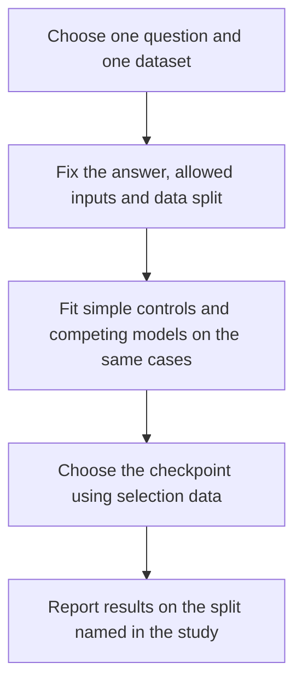
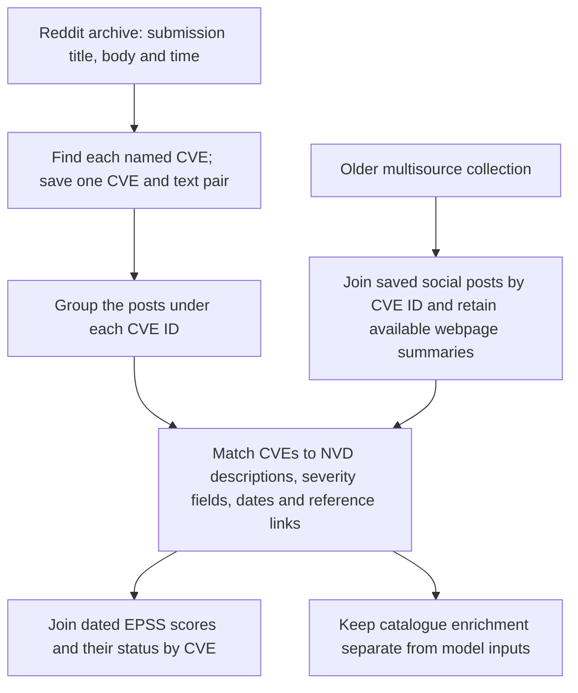
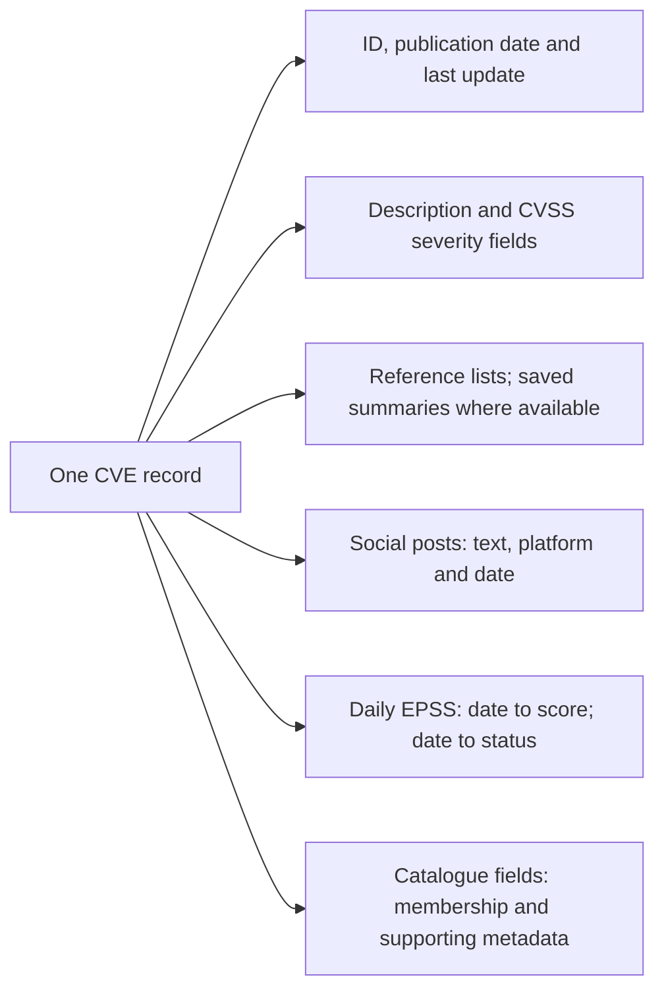
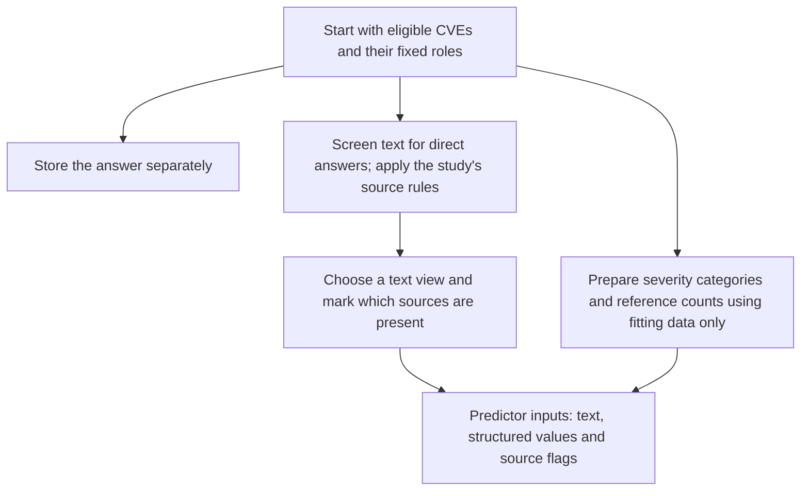
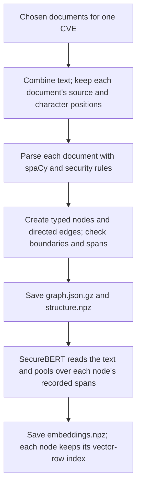
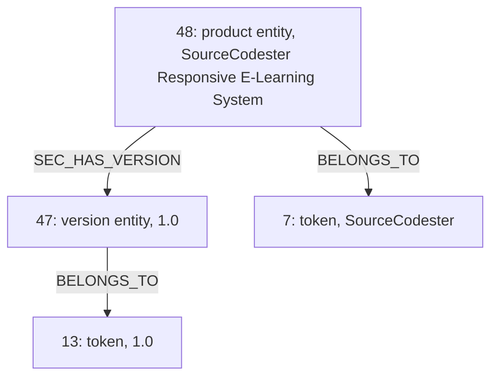
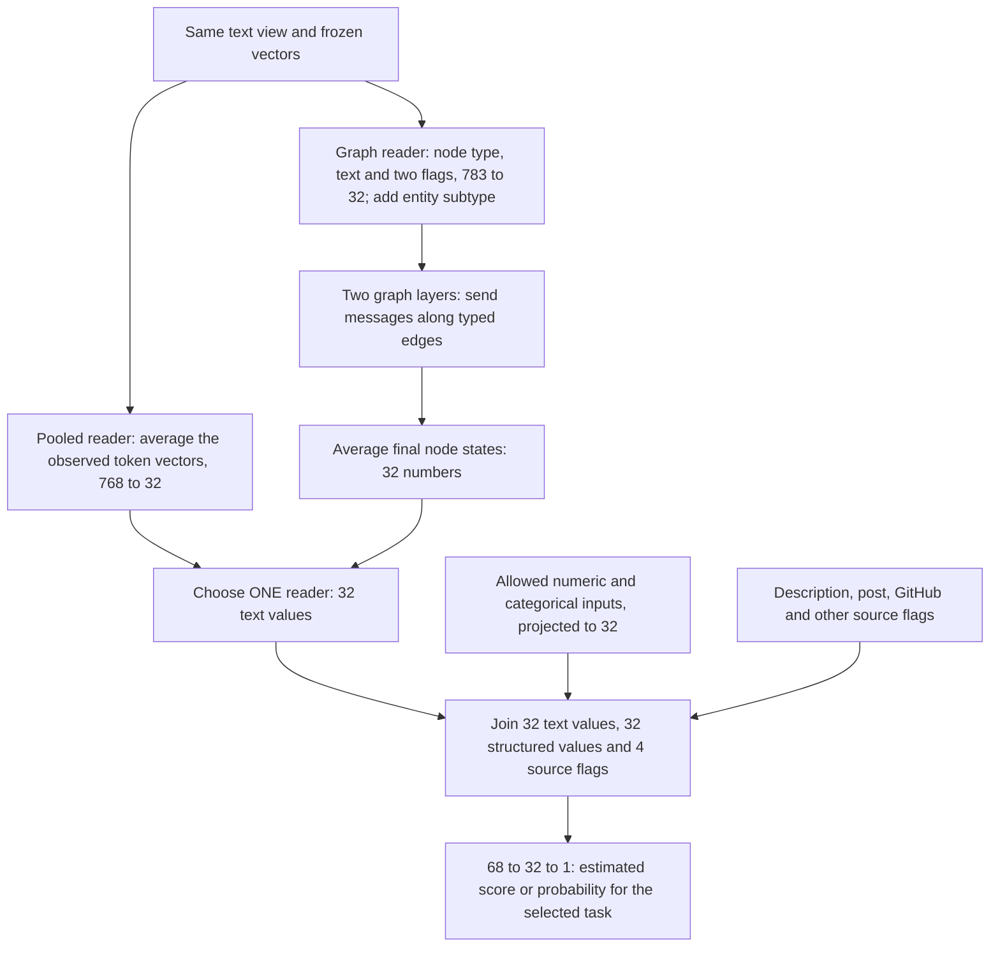

# Can public text help decide which vulnerabilities to review first?

Suppose two software flaws have the same severity rating, but a security team
has time to investigate only one today. People are discussing one of them
online. **Does reading what they say help the team decide which flaw to review
first?** We collected posts that name vulnerabilities so we could test that
idea. A mention alone is not proof of an attack: a warning posted before an
incident and a story shared afterward can use exactly the same words.

We started with a simple comparison: give a model the public description of
each flaw, then let it read the posts as well. Other comparisons ask what
linked webpages add and whether a graph helps the model read the same words.
The [six text cases](#4-what-did-each-case-study-read) explain the shorthand
used in the results.

**Start here:** [Run the example or a study, step by step](RUNBOOK.md) ·
[Find a script or config](INDEX.md) · [See the published results](published_results/MANIFEST.json).

## 1. Why start with EPSS, and what do we predict?

The **Exploit Prediction Scoring System (EPSS)** inspired the project because
it asks about *likelihood*, not just severity. It also gives us a public,
[dated score](https://www.first.org/epss/data.html) that can be joined to a
description or post using the same **CVE**, the public identifier for a
vulnerability. This lets us compare many cases on the same basis without
pretending we have a record of every attack.

**How the official system works.** The [original EPSS paper](https://doi.org/10.1145/3436242)
studied exploitation in the first year after disclosure. Today's EPSS answers
a different question: *how likely is exploitation in the next 30 days?*
FIRST describes roughly 2,850 features per vulnerability per day in its
current model. Examples include the age of the flaw, the affected product,
individual severity fields (such as what privileges are needed), how recently
security sources discussed it, and whether public exploit code or tools
exist. The model learns from exploitation activity observed by data partners.
It then updates the published scores each day as new information arrives.
Those observations are training evidence, not a complete list of attacks.
[How FIRST builds and scores EPSS](https://www.first.org/epss/how-it-works.html).

**Which paper describes which version?** The newest peer-reviewed model paper
listed on [FIRST's research page](https://www.first.org/epss/research) is
[Jacobs and colleagues' 2023 paper on EPSS v3](https://doi.org/10.1109/EuroSPW59978.2023.00027).
It describes 1,477 inputs, including three numerical measures of Twitter
discussion ([Table 1, open paper](https://weis2023.econinfosec.org/wp-content/uploads/sites/11/2023/06/weis23-jacobs.pdf)).
Public discussion was therefore already part of EPSS. Our question is narrower:
does reading the *words* of posts, rather than just knowing a CVE was
discussed, help prioritize it in our collections?

The latest production release is **v5**, which [started publishing scores on
15 June 2026](https://www.first.org/epss/data). FIRST reports changes to how it
detects and measures interest in public GitHub exploit code, how it converts
model output into probabilities, and the addition of VulnCheck KEV data.
The [v5 announcement](https://www.first.org/newsroom/releases/202606-036) is a
release note, not the v3 research paper. A score can change across a version
boundary even if nothing new happened to the vulnerability.

**What we do differently.** We use two smaller collections and far fewer
sources: the public description, social posts, webpage summaries where
available, **CVSS** (Common Vulnerability Scoring System) severity fields, and
counts of reference links. We do not have FIRST's partner sensor feeds.
We are not trying to rebuild FIRST's system. Its published score gives us
one way to check whether these smaller collections contain information that
matters for prioritization.

**How to read the cutoff.** FIRST does not define one EPSS score at which
everyone should act; that depends on the team's capacity and the systems it
protects. Our high-score study needed one repeatable yes/no question, so we
used **0.10**: an observed Day-60 score of 0.10 counts as high; 0.09 does not;
a missing score stays unknown. A score of 0.10 means an estimated 10% chance
of exploitation over the next 30 days, **not** the top 10% of CVEs or evidence
of an attack. Day 60 is when we read the score, measured from CVE publication.
[FIRST's threshold guidance](https://www.first.org/epss/faq).

| Study | Question | What counts as an answer? |
|---|---|---|
| FC01: estimate a score | Can the saved text and severity fields explain the EPSS score recorded on Day 60? | A number between 0 and 1. Compare errors against simple guesses such as the training mean. |
| ET02: identify a high score | Was the observed Day-60 EPSS **at least 0.1**? | Yes or no. The classifier never sees the score it is labeling. |
| CC03: identify a catalogue entry | Was this CVE in the verified VulnCheck catalogue snapshot? | Listed or not listed **in that snapshot**. A separately dated EPSS score is an allowed input here. |
| CF01: forecast a later score | Given only scores already observed, what will a later EPSS score be? | A later observed score. Compare against simply carrying forward the last known score. **No text graph** is used here. |

The first three studies use saved snapshots. They do **not** show that the text
was available before an attack, or that an attack actually happened. The two
classification studies have different labels and train separate models.



## 2. Where do the two datasets come from?

The daily EPSS file gives us a score, not the words people used when
discussing a flaw. We built the collections to put that discussion beside
the official description and the score history for the *same* CVE. Posts
were linked by CVE mention, not selected only when someone claimed an attack.
That distinction matters: a patch announcement, a bare CVE ID and a report
of active exploitation all mention a flaw, but they offer different evidence.

| Collection | Distinct CVEs in the collection | Train / validation for the Day-60 high-score study |
|---|---:|---:|
| Previous multisource collection | 5,968 | 2,546 / 1,104 |
| Reddit collection | 44,985 | 24,213 / 972 |

Why not train on every CVE in the table? A CVE without a recorded Day-60 score
has no answer for the high-score study. The remaining records must also meet
the study's split rules. Some CVEs appear in both collections, so we report
the datasets separately rather than adding their totals. The Reddit design
reserves 3,977 CVEs for testing; the earlier score-estimation study on the
older collection had 651 test CVEs. ET02 did not score either test set.



The Reddit scraper drops repeated **CVE/text pairs**. One post mentioning three
different CVEs can still be attached to all three. Its exported date is a day,
not a preserved edit history; it cannot prove the wording visible on that day.
The old collection has generated webpage summaries. A list of URLs in a Reddit
record is **not** a list of summaries.

See the [companion collection scripts](https://github.com/observatio/SummTPGVul/blob/publication/research-v1/README.md)
and [six-file data manifest](https://github.com/observatio/SummTPGVul/blob/publication/research-v1/DATASETS.json).
The diagram describes the data joins, not a claim that every historical
collector was recovered byte for byte.

## 3. What does one record contain?

Think of a record as a folder for one vulnerability. It can contain a
description, posts that mention it, links, and a history of scores. An empty
list of posts means there is no post to read, not that the flaw went unused.



For example, `description` is a text field; `cvss_vector` describes severity
categories; `github_only_urls` is a list. Each item in `social_media_posts`
has `post`, `platform` and `date`. The keys in `epss_scores` and
`epss_score_status` are **calendar dates**: Day 0 is publication day, and
Days 0 through 90 give up to 91 observations. A missing score is not zero.
Raw catalogue flags are not used as proof of a negative outcome.

## 4. What did each case study read?

The letters describe **what the model gets to read about one CVE**. They
do not describe different kinds of vulnerabilities. In these comparisons,
**D** is the public CVE description, **M** is the text of accepted social-media
posts (SMPs), and **U** is the saved, generated summary text of linked
webpages. U can include GitHub pages (**G**) and other reference pages (**N**).
The model reads the summary, not the URL itself.

| Case | Text the model can read | Question it helps answer |
|---|---|---|
| **D only** | The description, with no posts or summaries. | What can we learn from the published account of the flaw? |
| **M only** | Posts, without the description or summaries. | How useful is the public discussion when it is the only text available? |
| **U only** | Webpage summaries, without the description or posts. | How much can the material behind the reference links tell us on its own? |
| **DM** | The description and the posts. | Compared with D, does letting the model read the discussion help? |
| **DU** | The description and the webpage summaries. | Compared with D, do the linked pages add information the description left out? |
| **DMU** | The description, posts and webpage summaries. | Compared with DM, do summaries still help when the model can already read the posts? |

**“Only” applies to the text.** For example, the M-only model still gets the
same allowed severity fields and reference counts as the D-only model. The
structured-only control (**S** in the ET02 tables) gets those fields but no
text. The model also knows which text sources are present. If a CVE has no
accepted post, it stays in the DM comparison: the model reads its description
and gets a flag saying there was no post.

There are two different comparisons to read. Compare **pooled D with pooled
DM** to ask what posts add while keeping the reader the same. Compare
**pooled DM with TPG DM** to ask whether the graph helps while keeping the
text the same. In a combined case such as DM, the description and posts keep
their document boundaries; they are not treated as one author's statement.

**Which studies used these cases?** The Day-60 threshold study (ET02) ran
all six on each dataset. The final Reddit score comparison (FC01 Run 1) and
the catalogue study (CC03) used D and DM for their text models. The daily
forecast (CF01) read past EPSS scores, not text. A U row in ET02 means
summaries were allowed, not that every CVE had one: **885 of 1,104** older
validation CVEs had at least one accepted summary, versus **0 of 972** on
Reddit. On Reddit, 606 training CVEs did have one, so separately trained
DU and D models can give different answers even though both read just the
description at validation. [Older source counts](published_results/ET02/previous/support.json)
· [Reddit source counts](published_results/ET02/reddit/support.json).

Two earlier comparisons asked more specific questions. In [TRV04](EPSS_TPG/02_prediction/05_studies/05_tpg_revision/04_D_VS_DG.md),
**DG** added *only GitHub summaries* to the description, leaving out posts
and other webpages. In [CT07](EPSS_TPG/02_prediction/05_studies/07_combined_text_fresh/12_WITHIN_VERSION_FULL_RESULTS.md),
**DF** gave the model the description and a yes/no flag saying whether a post
existed, but not the post's words. Comparing DF with DM asks whether reading
the post helps beyond knowing someone wrote one.

This is how we prepare those comparisons without giving the model the answer:



A vendor can publish one advisory about three different flaws. We count its
link once for each CVE, not three times for one CVE and not just once for the
entire dataset. Shared posts also matter when splitting the data: a random
split could let a model see the same post in training and evaluation. The
studies track shared evidence and report overlap where it remains. CC03 also
screens text for passages that give away the catalogue answer. The
[structured encoder](EPSS_TPG/02_prediction/01_package/epss/reddit_primary/structured.py)
lists the allowed fields and shows how missing values are recorded.

## 5. How does text become a graph?



**spaCy and the graph rules describe relationships. SecureBERT describes the
text numerically.** A node can represent a token, phrase or entity. Its span
points back to the words it came from. The encoder is *frozen*: its weights do
not change during training. The graph and vectors are built once and reused.
An edge stores its two endpoints, type and properties; it does not get a
separate 768-number text vector.

Here is a real four-node excerpt from the older validation graph for
`CVE-2020-36084`. The product entity covers six tokens; only its first token
is shown. The two boxes reading **1.0** really are separate nodes: one is the
version entity and the other is the token in the sentence.



Those arrows follow the stored direction: edge `e183` goes from 48 to 47,
not from the token to the product. See the [graph builder](EPSS_TPG/01_tpg/10_extensions/tpg_combined_v2/graphs.py)
and [node-to-vector mapping](EPSS_TPG/01_tpg/10_extensions/tpg_combined_v3/compact.py).

## 6. How does the model make a prediction?

SecureBERT represents each token (a word or part of one) with a list of
numbers. The **pooled reader** averages those lists. The **text property
graph (TPG) reader** starts with
the same text but also follows its connections: in the example above, the
version belongs to a particular product. Both readers produce 32 numbers for
the text. Each model then joins its own 32 numbers with the structured
information to make a prediction.



In the graph reader, each node starts with 13 node-type indicators, 768 text
values, an embedding-present flag and a target-CVE-mention flag. Entity nodes
also get a projected subtype. For each edge the model uses its relation type
(23 possibilities) and 88 edge properties to send a message from sender to
receiver. A receiver adds its incoming messages before updating its state.
The task head and graph weights are learned; the cached SecureBERT vectors
stay unchanged. [Model implementation](EPSS_TPG/02_prediction/01_package/epss/combined_training_v1/model.py).

## 7. What did the comparisons show?

* **Could we estimate the exact Day-60 score more closely?** None of FC01
  Run 1's six main comparisons showed a clear reduction in error under the
  rule fixed before training. [Errors](published_results/FC01/run1/metrics.csv)
  · [Paired differences and uncertainty](published_results/FC01/run1/intervals.csv).
* **Catalogue membership:** the tree using EPSS and structured fields had the
  highest observed average precision on both datasets: **0.813** on the
  [previous collection](published_results/CC03/previous/summary.json) and **0.505**
  on [Reddit](published_results/CC03/reddit/summary.json). Average precision
  measures how well listed CVEs rise to the top of a ranking; it is not the
  percentage classified correctly. The Reddit pooled DM result also rounds to
  0.505. These results came from an assessment split inside the training role.
  One limitation: the [EPSS input was dated 17 November 2026](EPSS_TPG/02_prediction/04_configs/08_catalogue_classification/02_inputs_protocol.json),
  when v5 already incorporated VulnCheck data. The score and catalogue label
  may therefore share evidence. This does not tell us which individual scores
  were affected, and the ranking is not independent confirmation of exploitation.
* **Did posts help rank high Day-60 scores?** On the older validation set,
  the pooled reader's average precision went from **0.214** with the
  description (D) to **0.309** with the description and posts (DM). The graph
  reader scored **0.300** on that same DM case. Here, reading more text gave
  a higher observed ranking score; switching readers did not improve it.
  These are averages across training seeds, not evidence that a post predicted
  an attack. Only **50 of 1,104** older and **9 of 972** Reddit validation CVEs
  had high scores. On Reddit, finding just one more changes recall by one ninth.
  [Reddit comparison](published_results/ET02/reddit/validation_summary.csv)
  · [Older comparison](published_results/ET02/previous/validation_summary.csv).
* **Early warning remains unproven.** A separate check asked whether a model
  reading the description could improve on the EPSS score already known by
  Day 7. Of 7,797 cases, 62 later reached 0.10 by Day 90. Adding the model did
  not give a clear ranking gain under the agreed test. Even a gain there would
  concern a later **score rise**, not a later **attack**. Demonstrating an
  early warning from posts would require the actual wording available at the
  time and independent evidence of exploitation *after* that warning.
  [Early-warning comparison and decision](EPSS_TPG/02_prediction/05_studies/07_combined_text_fresh/21_DESCRIPTION_SURROGATE_RESULTS.md).

## Run it or check the results

```bash
git clone --branch publication/research-v1 --recurse-submodules https://github.com/Affan47/Text_property_Graph.git
cd Text_property_Graph
git submodule status --recursive
sha256sum -c published_results/SHA256SUMS
```

A fresh clone lets you check the result tables, inspect both implementations,
build a small example graph and run synthetic tests. For those commands,
environment setup, hyperparameters, full training commands and output paths,
use the [runbook](RUNBOOK.md). Exact historical reruns also need the original
role files, source receipts, caches and matching code. **The public download
is not a checkpoint archive.** Raw social posts, individual predictions,
credentials, restricted catalogue backups and thesis drafts are not included.

| What you can inspect | Where to go |
|---|---|
| Collectors and original data file identities | [Pinned data companion](SummTPGVul) |
| Graph extraction and the code that saves the vectors | [Graph core](EPSS_TPG/01_tpg/01_core/tpg) and [extensions](EPSS_TPG/01_tpg/10_extensions) |
| Datasets, models and evaluation code | [Prediction package](EPSS_TPG/02_prediction/01_package/epss) |
| Which script to run and with which settings | [Commands](RUNBOOK.md), [entry points](EPSS_TPG/02_prediction/03_analysis) and [configs](EPSS_TPG/02_prediction/04_configs) |
| Aggregate metrics, baseline results, uncertainty and sample counts | [19 files with original paths and checksums](published_results/MANIFEST.json) |

Earlier study notes are available under [study protocols](EPSS_TPG/02_prediction/05_studies).
Some earlier experiments have source and notes but no public result table;
in particular, the daily forecasting study is not one of the three result
bundles listed above. Optional applications and private annotation ledgers are
not required to run the example or the classifier tests.
