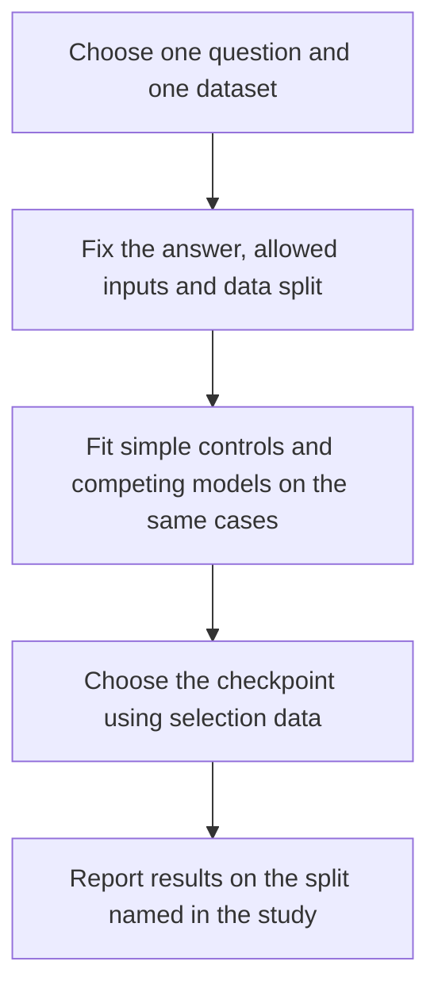
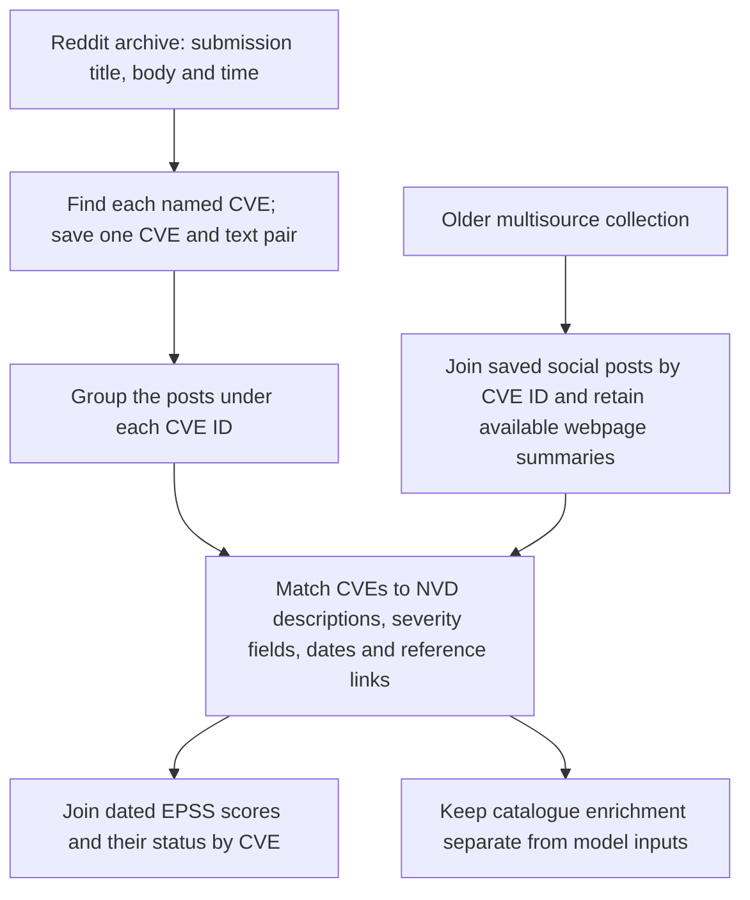
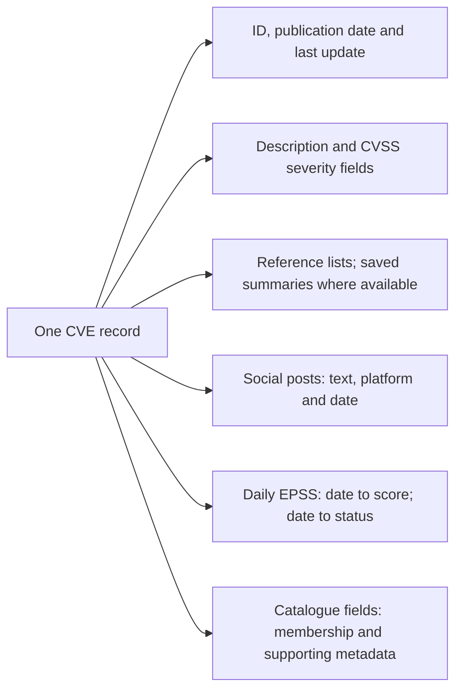
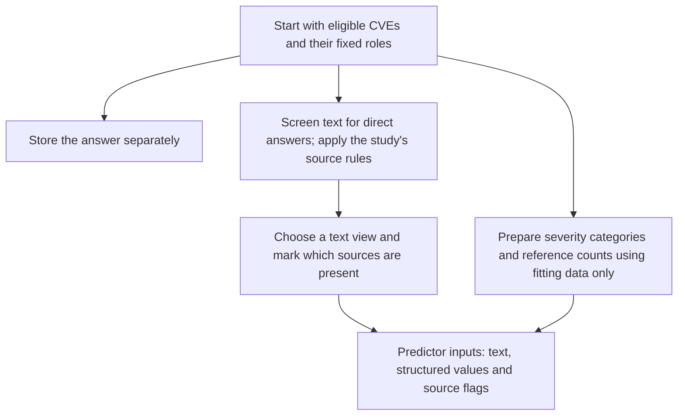
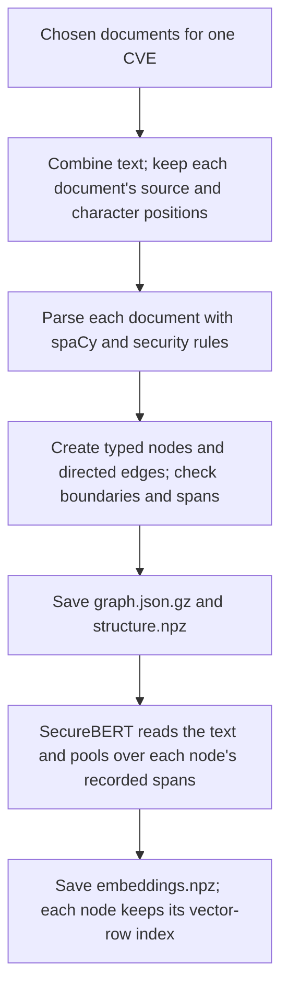
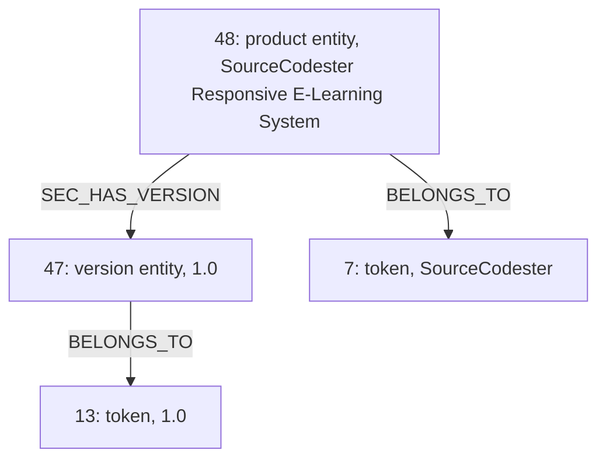
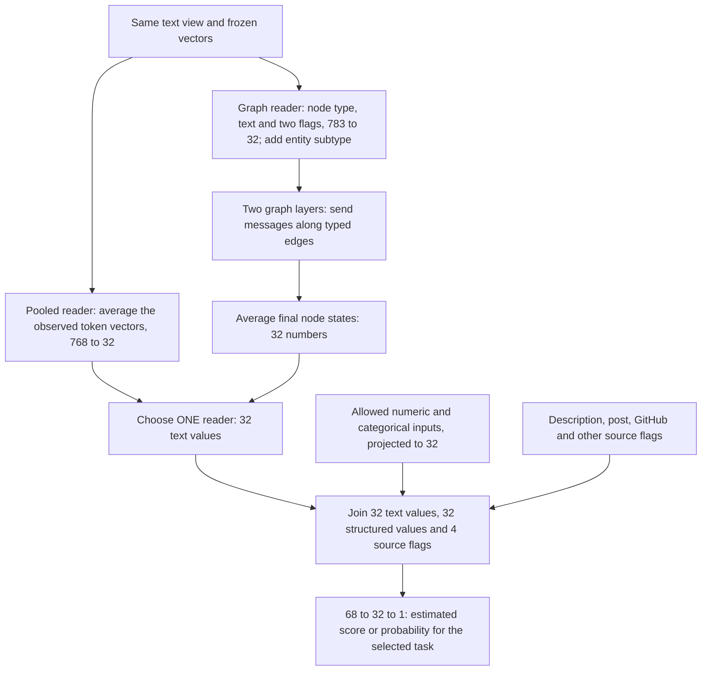

# Can public text help decide which vulnerabilities to review first?

A security team may have time to investigate only a few of the vulnerabilities
on its list. Severity tells the team how much damage a flaw could cause, not
whether anyone is likely to use it soon. **Can public discussion give the team
an early reason to look at one flaw before another?** That question is why we
collected social-media posts, including reports of exploitation, and linked
them to the vulnerabilities they name. A post is a possible clue, not a
verified attack. A warning before an incident and a repost after it may
contain the very same words.

**Start here:** [Run the example or a study, step by step](RUNBOOK.md) ·
[Find a script or config](INDEX.md) · [See the published results](published_results/MANIFEST.json).

## 1. Why start with EPSS, and what do we predict?

The **Exploit Prediction Scoring System (EPSS)** inspired the project because
it asks about *likelihood*, not just severity. It also gives us a public,
[dated score](https://www.first.org/epss/data.html) that can be joined to a
description or post using the same **CVE**, the public identifier for a
vulnerability. This lets us compare many cases on the same basis without
pretending we have a record of every attack.

**How the official system works.** The [original EPSS paper](https://doi.org/10.1145/3436242)
studied exploitation in the first year after disclosure. Today's EPSS answers
a different question: *how likely is exploitation in the next 30 days?*
FIRST describes roughly 2,850 features per vulnerability per day in its
current model. Examples include the age of the flaw, the affected product,
individual severity fields (such as what privileges are needed), how recently
security sources discussed it, and whether public exploit code or tools
exist. The model learns from exploitation activity observed by data partners.
It then updates the published scores each day as new information arrives.
Those observations are training evidence, not a complete list of attacks.
[How FIRST builds and scores EPSS](https://www.first.org/epss/how-it-works.html).

**What we do differently.** We use two smaller collections and far fewer
sources: the public description, social posts, webpage summaries where
available, **CVSS** (Common Vulnerability Scoring System) severity fields, and
counts of reference links. We do not have FIRST's partner sensor feeds.
Rather than rebuild EPSS, we compare the same CVEs with and without post text,
and compare averaging the words' vectors with reading their relationships in
a text property graph. The question is what those public sources *add*.

**How to read the cutoff.** FIRST does not define one EPSS score at which
everyone should act; that depends on the team's capacity and the systems it
protects. Our high-score study needed one repeatable yes/no question, so we
used **0.10**: an observed Day-60 score of 0.10 counts as high; 0.09 does not;
a missing score stays unknown. A score of 0.10 means an estimated 10% chance
of exploitation over the next 30 days, **not** the top 10% of CVEs or evidence
of an attack. Day 60 is when we read the score, measured from CVE publication.
[FIRST's threshold guidance](https://www.first.org/epss/faq).

| Study | Question | What counts as an answer? |
|---|---|---|
| FC01: estimate a score | Can the saved text and severity fields explain the EPSS score recorded on Day 60? | A number between 0 and 1. Compare errors against simple guesses such as the training mean. |
| ET02: identify a high score | Was the observed Day-60 EPSS **at least 0.1**? | Yes or no. The classifier never sees the score it is labeling. |
| CC03: identify a catalogue entry | Was this CVE in the verified VulnCheck catalogue snapshot? | Listed or not listed **in that snapshot**. A separately dated EPSS score is an allowed input here. |
| CF01: forecast a later score | Given only scores already observed, what will a later EPSS score be? | A later observed score. Compare against simply carrying forward the last known score. **No text graph** is used here. |

The first three studies use saved snapshots. They do **not** show that the text
was available before an attack, or that an attack actually happened. The two
classification studies have different labels and train separate models.



## 2. Where do the two datasets come from?

The daily EPSS file gives us a score, not the words people used when
discussing a flaw. We built the collections to put that discussion beside
the official description and the score history for the *same* CVE. Posts
were linked by CVE mention, not selected only when someone claimed an attack.
That distinction matters: a patch announcement, a bare CVE ID and a report
of active exploitation all mention a flaw, but they offer different evidence.

| Collection | Distinct CVEs in the collection | Train / validation for the Day-60 high-score study |
|---|---:|---:|
| Previous multisource collection | 5,968 | 2,546 / 1,104 |
| Reddit collection | 44,985 | 24,213 / 972 |

The collections share some CVEs. They are **not** added together or trained
as one dataset. The Day-60 study needs an observed Day-60 score and an eligible
split. The Reddit design separately reserves 3,977 test CVEs; the earlier
primary regression on the previous collection had 651 held-out CVEs. ET02 did
not score either test set.



The Reddit scraper drops repeated **CVE/text pairs**. One post mentioning three
different CVEs can still be attached to all three. Its exported date is a day,
not a preserved edit history; it cannot prove the wording visible on that day.
The old collection has generated webpage summaries. A list of URLs in a Reddit
record is **not** a list of summaries.

See the [companion collection scripts](https://github.com/observatio/SummTPGVul/blob/publication/research-v1/README.md)
and [six-file data manifest](https://github.com/observatio/SummTPGVul/blob/publication/research-v1/DATASETS.json).
The diagram describes the data joins, not a claim that every historical
collector was recovered byte for byte.

## 3. What does one record contain?

The diagram groups fields by meaning. It is a map of a JSON record, not a
database schema that requires every field to be present.



For example, `description` is a text field; `cvss_vector` describes severity
categories; `github_only_urls` is a list. Each item in `social_media_posts`
has `post`, `platform` and `date`. The keys in `epss_scores` and
`epss_score_status` are **calendar dates**: Day 0 is publication day, and
Days 0 through 90 give up to 91 observations. A missing score is not zero.
Raw catalogue flags are not used as proof of a negative outcome.

## 4. Which information goes into the experiment?



**D** means description; **M** means accepted social-media prose; **U** means
summaries of GitHub (**G**) and other (**N**) reference pages. ET02 compares
**D, M, U, DM, DU and DMU**. For DM, for example, the description and accepted
posts form one text view with boundaries between documents. A missing source
gets an explicit flag; it is not a reason to drop the CVE. CC03 uses only D
and DM and screens for direct catalogue answers.

Duplicate references are counted once **within** each CVE. Shared references
are not deleted from other CVEs. The split rules account for time and shared
evidence; a random split could place the same post on both sides. Some residual
overlap is reported rather than assumed away. The [structured encoder](EPSS_TPG/02_prediction/01_package/epss/reddit_primary/structured.py)
shows which fields are allowed and how missing values are represented.

## 5. How does text become a graph?



**spaCy and the graph rules describe relationships. SecureBERT describes the
text numerically.** A node can represent a token, phrase or entity. Its span
points back to the words it came from. The encoder is *frozen*: its weights do
not change during training. The graph and vectors are built once and reused.
An edge stores its two endpoints, type and properties; it does not get a
separate 768-number text vector.

Here is a real four-node excerpt from the older validation graph for
`CVE-2020-36084`. The product entity covers six tokens; only its first token
is shown. The two boxes reading **1.0** really are separate nodes: one is the
version entity and the other is the token in the sentence.



Those arrows follow the stored direction: edge `e183` goes from 48 to 47,
not from the token to the product. See the [graph builder](EPSS_TPG/01_tpg/10_extensions/tpg_combined_v2/graphs.py)
and [node-to-vector mapping](EPSS_TPG/01_tpg/10_extensions/tpg_combined_v3/compact.py).

## 6. How does the model make a prediction?



The pooled and graph readers are **alternatives**, not two inputs used together.
In the graph reader, each node starts with 13 node-type indicators, 768 text
values, an embedding-present flag and a target-CVE-mention flag. Entity nodes
also get a projected subtype. For each edge the model uses its relation type
(23 possibilities) and 88 edge properties to send a message from sender to
receiver. A receiver adds its incoming messages before updating its state.
The task head and graph weights are learned; the cached SecureBERT vectors
stay unchanged. [Model implementation](EPSS_TPG/02_prediction/01_package/epss/combined_training_v1/model.py).

## 7. What did the comparisons show?

* **Day-60 score:** none of FC01 Run 1's six main comparisons showed a clear
  reduction in error under the rule fixed before training. [Errors](published_results/FC01/run1/metrics.csv)
  · [Paired differences and uncertainty](published_results/FC01/run1/intervals.csv).
* **Catalogue membership:** the tree using EPSS and structured fields had the
  highest observed average precision on both datasets: **0.813** on the
  [previous collection](published_results/CC03/previous/summary.json) and **0.505**
  on [Reddit](published_results/CC03/reddit/summary.json). Average precision
  measures how well listed CVEs rise to the top of a ranking; it is not the
  percentage classified correctly. The Reddit pooled DM result also rounds to
  0.505. These results came from an assessment split inside the training role.
* **High Day-60 EPSS:** only **9 of 972** Reddit validation CVEs and **50 of
  1,104** older validation CVEs had scores at or above 0.1. On Reddit, one
  additional hit changes recall by one ninth. No Reddit validation CVE had an
  accepted webpage summary, so those results cannot measure the benefit of
  reading a summary there. [Reddit comparison](published_results/ET02/reddit/validation_summary.csv)
  · [Older comparison](published_results/ET02/previous/validation_summary.csv).
* **Early warning remains unproven.** A separate check asked whether a model
  reading the description could improve on the EPSS score already known by
  Day 7. Of 7,797 cases, 62 later reached 0.10 by Day 90. Adding the model did
  not give a clear ranking gain under the agreed test. Even a gain there would
  concern a later **score rise**, not a later **attack**. Demonstrating an
  early warning from posts would require the actual wording available at the
  time and independent evidence of exploitation *after* that warning.
  [Early-warning comparison and decision](EPSS_TPG/02_prediction/05_studies/07_combined_text_fresh/21_DESCRIPTION_SURROGATE_RESULTS.md).

## Run it or check the results

```bash
git clone --branch publication/research-v1 --recurse-submodules https://github.com/Affan47/Text_property_Graph.git
cd Text_property_Graph
git submodule status --recursive
sha256sum -c published_results/SHA256SUMS
```

A fresh clone lets you check the result tables, inspect both implementations,
build a small example graph and run synthetic tests. For those commands,
environment setup, hyperparameters, full training commands and output paths,
use the [runbook](RUNBOOK.md). Exact historical reruns also need the original
role files, source receipts, caches and matching code. **The public download
is not a checkpoint archive.** Raw social posts, individual predictions,
credentials, restricted catalogue backups and thesis drafts are not included.

| What you can inspect | Where to go |
|---|---|
| Collectors and original data file identities | [Pinned data companion](SummTPGVul) |
| Graph extraction and the code that saves the vectors | [Graph core](EPSS_TPG/01_tpg/01_core/tpg) and [extensions](EPSS_TPG/01_tpg/10_extensions) |
| Datasets, models and evaluation code | [Prediction package](EPSS_TPG/02_prediction/01_package/epss) |
| Which script to run and with which settings | [Commands](RUNBOOK.md), [entry points](EPSS_TPG/02_prediction/03_analysis) and [configs](EPSS_TPG/02_prediction/04_configs) |
| Aggregate metrics, baseline results, uncertainty and sample counts | [19 files with original paths and checksums](published_results/MANIFEST.json) |

Earlier study notes are available under [study protocols](EPSS_TPG/02_prediction/05_studies).
Some earlier experiments have source and notes but no public result table;
in particular, the daily forecasting study is not one of the three result
bundles listed above. Optional applications and private annotation ledgers are
not required to run the example or the classifier tests.
